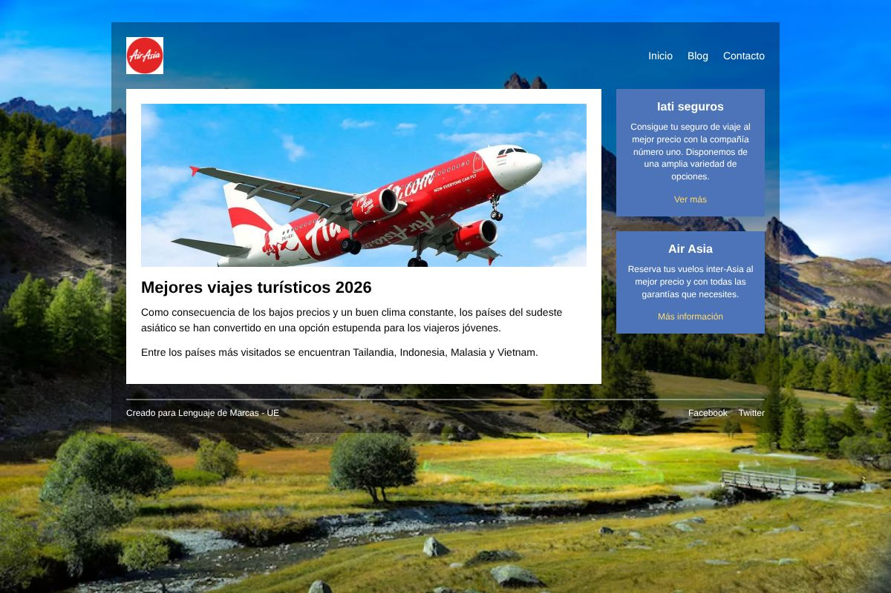
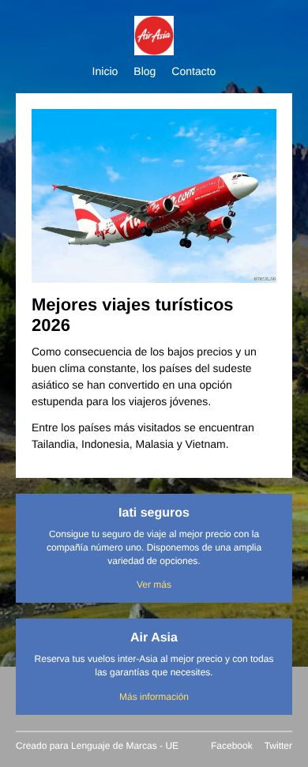

# Blog de viajes · Maquetación con Flexbox

Maqueta de una página de blog de viajes hecha solo con **HTML5 y CSS3**, sin frameworks. Toda la distribución (cabecera, contenido principal, barra lateral y pie) está construida con **Flexbox** y se adapta a móvil.

> Práctica del módulo de Lenguaje de Marcas (1.º DAW, Universidad Europea).

🔗 **Demo:** https://madurga1.github.io/2--Actividad-evaluable-Lenguaje-de-Marcas/



## Qué demuestra

- **Layout con Flexbox**: cabecera con logo y menú alineados con `justify-content: space-between`, y una columna principal y otra lateral repartidas con `flex: 3` / `flex: 1`.
- **Diseño responsive**: con una media query a 700 px, el lateral pasa debajo del artículo y la cabecera se apila en vertical.
- **HTML semántico**: `header`, `nav`, `main`, `aside` y `footer`.
- **CSS ordenado** por bloques, con clases descriptivas y un reset básico (`box-sizing: border-box`).
- Detalles visuales: imagen de fondo fija, capa semitransparente sobre el fondo y `object-fit: cover` para recortar la imagen del artículo sin deformarla.

## Vista en móvil



## Estructura

```
├── index.html     # Estructura de la página
├── styles.css     # Estilos y media query
└── img/           # Imágenes del logo, artículo y fondo
```

## Cómo verlo en local

No necesita instalación: clona el repositorio y abre `index.html` en el navegador.

```bash
git clone https://github.com/Madurga1/2--Actividad-evaluable-Lenguaje-de-Marcas.git
```

## Posibles mejoras

- Pasar los colores y tamaños a variables CSS (`--color-primario`, etc.).
- Menú hamburguesa en móvil.
- Optimizar las imágenes (WebP/AVIF con `srcset`).
